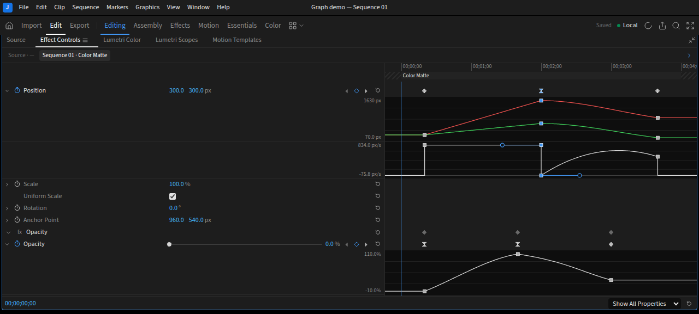

# graph-editor — Value / Velocity graphs in Effect Controls

Branch `wave1/graph-editor`. Spec: S03 **KF-022** (graphs), §12.2 evaluation, KF-020 interpolation presets,
EC-005 (twirl), EC-023 (key drags), PRP-023 / ARC-005 (transient gestures); S05 **ECP-005 / ECP-006**.

## What was built

| Behaviour | Where | Notes |
|---|---|---|
| Twirl on every continuous `number` / `vec2` row | `PropertyRow.tsx` (`twirl` prop), `EffectControlsPanel.tsx` | Effect Controls only; rows without graphs keep an empty 13 px slot so stopwatches line up. Open rows + heights persist per panel instance (`jasper.ec.<id>.graphs`). |
| Value graph (top) + Velocity graph (bottom), min/max labels at the left | `GraphEditor.tsx` | One block below the row, split 55 / 45. Labels use the property unit (`%`, `px`, `°`; velocity `…/s`). |
| Curves sampled from the shared `evaluate()` | `graph.ts` `sampleValueCurves` | Never re-implemented: points are `evaluate(anim, t, propertyEvaluateOptions(spec))` (the resolver's own options, now exported from `@jasper/project`). vec2 shows X (red) and Y (green). Holds draw vertical steps. |
| Velocity curve | `graph.ts` `sampleVelocityCurve` | Numeric derivative of `evaluate()` per segment (one-sided at keys, so in/out speed jumps are vertical). Units / s of sequence time; signed for numbers, speed along the path for vec2. Reversed / sped-up clips map through the clip's time map. |
| Drag a Value-graph key | `GraphEditor.tsx` `onValueKeyDown` | Vertical → `keyframe.update {value}` (rounded to step/100, clamped by the handler); horizontal → `keyframe.move` by whole frames with the lanes' snapping (playhead, clip edges, other keys; Shift = no snap). A 5 px horizontal dead zone keeps vertical drags from nudging time. Multi-selection: same value delta for the selected keys of this property, time move for all selected keys. vec2: one point per dimension, each drags its component. |
| Value-graph Bezier handles | `graph.ts` `valueHandles` / `easeFromValueDrag` | Numbers, selected Bezier / Continuous keys: the cubic control point (`influence·T`, `influence·slope·Δv`). |
| Velocity-graph direction handles | `graph.ts` `velocityHandles` / `easeFromVelocityDrag` | Selected keys, every interpolated side (also Linear / Auto). Vertical → speed, horizontal → influence clamped to 0.01..1; slope clamped ≥ 0. |
| Handle → commands | `graph.ts` `planEaseEdit` | Continuous Bezier stays linked (only the dragged side is sent; `keyframe.update` matches the other side's speed). Alt / Option (at pointer-down or mid-drag) breaks the link → Bezier. Linear / Auto keys convert to Bezier with the untouched side frozen at its current effective ease. Holds keep holding. An arriving side after a Linear key needs that key to be Bezier (linear-equivalent eases) to show: the handler already does this for Bezier targets; `planEaseEdit` adds it for Continuous (both sides, since they are linked) and Hold targets. No command changes were needed. |
| One undo entry, live preview | `startDrag` in `GraphEditor.tsx` | Every drag is one `ops.scrub` gesture: transient document while dragging (Program Monitor, lanes and the graphs update live, ARC-005), one History entry on release, Esc cancels. The vertical scale is frozen during a drag so the grabbed point stays under the pointer. |
| Auto-fit, resize, zoom/scroll | `fitRange`, resize grip | 10 % headroom around the visible part of the curve (velocity always includes 0); bottom-edge grip resizes 80–480 px. The x axis is the panel's mini-timeline `range`, so it follows whatever range the lanes use. |
| Shared selection + context menu | `pickKey`, `openKeyMenu` | Same rule as the lanes (click selects / keeps a multi-selection, Shift/Ctrl/Cmd toggles); graph points carry `data-kf-id`, so the panel marquee also hits them (ids are de-duplicated). Right-click opens the same Temporal Interpolation menu. |

## Units and conversions

The document stores `ease = {influence, slope}` with `slope` normalised to the segment's average speed
(S01:KF-003). A handle's speed is `slope × unit`, where `unit` is the display velocity of the segment when it
is linear-equivalent. `unitVelocity` **measures** it from `evaluate()` on a copy of the keyframes whose two
segment keys get linear-equivalent eases (progress = u exactly), so the conversion follows whatever distance
the evaluator normalises by — including curved spatial vec2 paths when that work lands — without knowing it.

## Tests

- `apps/web/test/effect-controls-graph.test.ts` — time map vs. the lanes' `exactFrameOf` (normal, sped-up,
  reversed), value sampling equals `evaluate`, holds / clamps, velocity of linear / eased / vec2 / reversed
  segments, handles sit on the sampled curve, drag ↔ ease round trips and clamps, `planEaseEdit` cases, and an
  end-to-end check through the real command handlers (dragging a velocity handle to −120 / s yields −120 / s
  from the evaluator).
- `apps/web/test/effect-controls-graph-ui.test.tsx` (happy-dom) — twirl + labels + persistence, value-key
  vertical / horizontal drags (one undo entry, transient preview, Esc cancel), velocity handle speed /
  influence / clamps, Linear → Bezier, Continuous linked vs. Alt-broken, value-graph handles, shared selection
  with the lanes, context menu, resize.
- `e2e/graph-editor.spec.ts` — the same flow with real pointer events in the built app.

## Known gaps

keyframes-blend closed the earlier gaps (overshoot / anticipation through the handles with signed slopes, a smooth
signed velocity through a Continuous key at a 1-D extremum, vec2 Bezier handles on the X / Y value curves,
independent vertical zoom / pan with Auto-fit per graph); see `docs/wp-notes/keyframes-blend.md`. Still true:

- A segment with no value change (Δv = 0) has no speed scale: eases are stored as slopes normalised by the
  segment's average speed, so a flat segment cannot carry an overshoot bump; its handles change influence only
  (a vec2 component that does not change along the segment likewise).
- Velocity key markers select keys but are not draggable themselves (handles are).
- Horizontal zoom follows the panel range (the panel itself has no zoom bar yet).
